# Phase 4C – CISLR Integration Feasibility Study

**Project:** SAKSHAM V1  
**Phase:** 4C – CISLR Integration (Audit & Design Only)  
**Dataset:** [Exploration-Lab/CISLR](https://huggingface.co/datasets/Exploration-Lab/CISLR)  
**Paper:** [CISLR: Corpus for Indian Sign Language Recognition (EMNLP 2022)](https://aclanthology.org/2022.emnlp-main.707/)  
**Status:** Feasibility study complete — **no training, no GRU implementation, no runtime changes**

---

## Executive Summary

CISLR is the right strategic dataset for scaling SAKSHAM beyond a handcrafted 7–10 sign vocabulary to a large ISL lexicon. The corpus provides **~4,765 word-level glosses** across **~7,050 RGB videos** sourced from ISL dictionary channels, with **71 signers** and broad topical coverage.

However, CISLR is fundamentally a **low-shot corpus** (~**1.5 videos per gloss** on average). A vanilla supervised GRU trained on the full vocabulary is **not feasible**. SAKSHAM V1 should adopt a **tiered vocabulary strategy**:

| Tier | Vocabulary | Training approach |
|------|------------|-------------------|
| **V1-A (bootstrap)** | 10 SAKSHAM target signs | Direct supervised GRU on CISLR rows + augmentation |
| **V1-B (expanded)** | 50–150 high-frequency / multi-sample glosses | Filtered supervised GRU |
| **V1-C (stretch)** | 300–500 glosses | Transfer learning + heavy augmentation |
| **Full CISLR** | ~4,765 glosses | Prototype / metric learning (paper baseline), not plain GRU softmax |

The existing SAKSHAM training stack (MediaPipe landmarks → wrist-centered normalization → 24-frame sequences → GRU tensors) is **architecturally compatible** with CISLR. The main risks are **class imbalance**, **singleton glosses**, and **domain shift** between dictionary videos and live webcam inference.

---

## 1. Dataset Acquisition

### 1.1 Hugging Face Layout

```
cislr_data/
├── dataset.csv              # All videos + gloss annotations
├── prototype.csv            # One-shot prototype split
├── test.csv                 # One-shot test queries
├── README.md
├── CISLR_v1.5-a_videos/
│   └── *.mp4                # ~7,050 MP4 clips (distributed as zip on HF)
└── I3D_features.pkl         # Precomputed I3D features (optional baseline reference)
```

**Total HF repo size:** ~1.59 GB (videos shipped as `CISLR_v1.5-a_videos.zip`).

### 1.2 Download Procedure

CISLR is a **gated dataset**. Web approval alone is not enough — the local machine must authenticate:

```powershell
# 1. Accept terms at https://huggingface.co/datasets/Exploration-Lab/CISLR
# 2. Authenticate
hf auth login

# 3. Download into cislr_data/
python tools/cislr/download_dataset.py

# Metadata only (fast sanity check)
python tools/cislr/download_dataset.py --metadata-only

# Full audit after download
python tools/cislr/audit_dataset.py --dataset-root cislr_data
```

> **Note:** During this audit session, gated files returned `401 Unauthorized` / `Access denied` because no local HF token was configured. Published paper statistics below are used as the authoritative baseline until `hf auth login` is completed and `audit_dataset.py` is run on the live files.

---

## 2. Dataset Audit

### 2.1 Published Corpus Statistics (Paper + HF Card)

| Metric | Value | Source |
|--------|-------|--------|
| Total videos | **7,050** | Paper Table 1 |
| Unique glosses (words) | **4,765** | Paper Table 1 |
| Avg videos per gloss | **~1.5** | Paper Table 1 |
| Unique signers | **71** | Paper Table 1 |
| Word categories (manual) | **57** | Paper Appendix Table 5 |
| WLASL vocabulary overlap | **1,282 words** | Paper §3 |
| Video modality | RGB MP4 | Paper / HF README |
| Sources | ISLRTC + IndianSignLanguage.org (YouTube) | Paper §3 |

### 2.2 Expected CSV Schema

Based on SAKSHAM tooling tests and the HF README, `dataset.csv` is expected to contain at minimum:

| Column (expected) | Description |
|-------------------|-------------|
| `word` / `gloss` | English gloss label |
| `video_id` | YouTube-style video UID (maps to `{video_id}.mp4`) |
| `signer_id` | Signer identifier (if present) |

The audit script auto-detects label, video, and signer columns.

### 2.3 Class Distribution (Expected)

From the paper's one-shot formulation:

| Split artifact | Rows | Role |
|----------------|------|------|
| `prototype.csv` | ~4,765 | One prototype video per unique gloss |
| `test.csv` | ~2,285–4,927 | Remaining query videos (depends on v1.0-a/b/ab split) |
| `dataset.csv` | ~7,050 | Full union |

**Distribution shape (inferred):**

- **Majority of glosses:** 1 video (singleton class)
- **Some glosses:** 2 videos (signer repeats gesture twice in same clip — paper splits these into v1.0-a / v1.0-b halves)
- **Rare glosses:** 3+ videos

This implies:

```
Singleton glosses:     ~60–70%  (estimated)
Glosses with ≥2:       ~30–40%
Glosses with ≥5:       <5%      (very few)
Glosses with ≥10:      <1%      (extremely rare)
```

### 2.4 Top Signs

CISLR is **not frequency-balanced** — it is a dictionary corpus where each word appears roughly once. "Top 100 most frequent signs" will likely be words with **2–3 videos** (repeated-sign clips), not hundreds of instances. The audit script (`audit_dataset.py`) computes the exact ranking once data is local.

**Top categories by vocabulary size** (from paper Appendix Table 5):

| Category | Videos |
|----------|--------|
| action | 718 |
| geography | 426 |
| banking | 358 |
| time | 304 |
| flora and fauna | 300 |
| attribute | 243 |
| foods and drinks | 227 |
| profession | 206 |
| biology | 200 |
| legal | 184 |

### 2.5 Signer Information

- **71 unique signers** across ISLRTC and IndianSignLanguage.org sources
- Signer ID column expected in metadata (auto-detected by audit tooling)
- **Signer-disjoint splits are mandatory** — SAKSHAM's `split_records_by_signer()` (70/15/15) is the correct strategy
- Risk: many glosses have only one signer, so signer split ≠ class split

### 2.6 Video Format & Storage

| Property | Expected value |
|----------|----------------|
| Container | MP4 (H.264 / AVC) |
| Resolution | Variable (dictionary crop; typically 480p–720p) |
| FPS | ~25 (common for YouTube dictionary sources) |
| Duration | Short clips (~2–8 seconds per word) |
| Content | Single signer, cropped frame, sometimes pictorial overlays removed |
| Naming | `{youtube_video_id}.mp4` |
| On-disk size | ~1.5 GB compressed |

**Projected landmark storage** (full corpus, uncompressed NPZ):

```
7,050 videos × ~75 frames avg × 516 bytes/frame ≈ 270 MB landmark tensors
+ quality masks/metadata ≈ 350–500 MB total processed artifacts
```

Recommended working disk: **≥ 5 GB** (raw videos + extracted landmarks + training checkpoints).

---

## 3. SAKSHAM Target Overlap

SAKSHAM V1 target vocabulary (from `tools/normalize_labels.py`):

```
HELLO, HELP, STOP, YES, NO, WATER, THANK YOU, PLEASE, SORRY, NO_SIGN
```

These are common dictionary words and **are expected to exist in CISLR**, likely with 1–2 videos each. Exact counts require running:

```powershell
python tools/count_targets.py --input cislr_data/dataset.csv
python tools/cislr/audit_dataset.py --dataset-root cislr_data
```

**Strategic value:** CISLR rows for these 10 glosses provide a **bootstrap validation set** to compare heuristic recognition (current `SignLanguageEngine`) against a trained GRU before scaling vocabulary.

---

## 4. Pipeline Suitability Assessment

### 4.1 Stage-by-Stage Verdict

```
CISLR Video → MediaPipe Extraction → Landmark Normalization → Sequence Generation → GRU Training → ONNX Export → SAKSHAM Inference
```

| Stage | Suitable? | Confidence | Rationale |
|-------|-----------|------------|-----------|
| **MediaPipe Landmarks** | ✅ Yes | High | Dictionary videos show clear signer crops; SAKSHAM `HandTracker` already extracts 21-point 3D landmarks per hand |
| **Landmark Normalization** | ✅ Yes | High | `normalize_hand_sequence()` (wrist origin, MCP scale) matches `tools/cislr/utils.py` conventions |
| **Sequence Windows** | ✅ Yes | High | `preprocess_sample_for_gru()` pads/truncates to 24 frames → tensor shape `[24, 128]` (2 hands × 63 + 2 presence flags) |
| **GRU Training** | ⚠️ Partial | Low–Medium | Works for **filtered vocabularies** (50–500 classes). Full 4,765-class softmax is data-starved |
| **ONNX Export** | ✅ Yes | High | Fixed-shape GRU `[1, 24, 128] → [1, num_classes]` exports cleanly to ONNX Runtime |
| **SAKSHAM Runtime** | ⚠️ Partial | Medium | Runtime still uses heuristic rules (`SignLanguageEngine`); ONNX integration is a future phase. Webcam domain shift from dictionary videos is the main accuracy risk |

### 4.2 Key Risks

1. **Singleton classes** — ~70% of glosses have one video; cannot do train/val/test per class without augmentation or leave-one-out evaluation.
2. **Two-hand variability** — ISL is two-handed; MediaPipe may miss the non-dominant hand in some dictionary crops.
3. **Domain shift** — Dictionary videos (studio crop, fixed camera) ≠ live webcam (variable lighting, background, signer).
4. **Pictorial overlays** — Some source videos contained word images; paper authors cropped these out, but residual artifacts may confuse landmark extraction.
5. **Repeated-sign splits** — Paper v1.0-ab artificially boosts accuracy to 43% Top-1 by treating repeated halves as separate samples from the same clip.

### 4.3 Key Strengths

1. **Largest ISL word-level vocabulary** publicly available (4,765 glosses).
2. **Compatible tensor format** — CISLR landmarks can be stored in the same NPZ schema as `DatasetManager` accepted clips.
3. **Existing preprocessing chain** — Phase 4 training modules (`loader.py`, `preprocessing.py`, `splits.py`, `normalization.py`) require no architectural changes.
4. **Signer diversity** — 71 signers enable meaningful signer-disjoint evaluation.
5. **I3D features included** — Optional baseline comparison against paper's 16.8% / 43.4% one-shot results.

---

## 5. V1 Recommendations

### 5.1 Recommended Vocabulary Size

| Phase | Vocabulary | Rationale |
|-------|------------|-----------|
| **V1 launch** | **50 glosses** | Balances utility and trainability; select glosses with ≥2 videos + SAKSHAM targets |
| **V1.1** | **150 glosses** | Add high-category words (greetings, actions, numbers, common nouns) with augmentation |
| **V2** | **500 glosses** | Requires transfer from WLASL/OpenHands + heavy augmentation |
| **Full CISLR** | 4,765 | Metric / prototype learning, not standard GRU softmax |

### 5.2 Minimum Samples Per Class

| Training mode | Min samples/class | Notes |
|---------------|-------------------|-------|
| Heuristic baseline | 1 | Current SAKSHAM approach |
| GRU (V1 filtered) | **≥ 5** (target **≥ 10** with augmentation) | SAKSHAM `DatasetManager` recommends 40 clips/sign for live collection |
| GRU (production) | **≥ 20** | For stable webcam generalization |
| One-shot / prototype | **1 prototype + 1 query** | Matches paper's CISLR evaluation protocol |

### 5.3 Expected Training Dataset Size

| Scenario | Classes | Raw videos | Augmented sequences | Trainable? |
|----------|---------|------------|---------------------|------------|
| SAKSHAM bootstrap | 10 | ~15–20 | ~200 (10× temporal crop + mirror) | ✅ Yes |
| V1 filtered | 50 | ~75–100 | ~1,000 | ✅ Yes |
| V1 expanded | 150 | ~200–300 | ~3,000 | ✅ Yes (with aug) |
| Full CISLR | 4,765 | 7,050 | 7,050 (no aug) | ❌ No (for GRU softmax) |

### 5.4 Expected Accuracy Range

| Setup | Top-1 Accuracy | Basis |
|-------|----------------|-------|
| Paper I3D one-shot (v1.0-a) | **16.8%** | CISLR paper Table 4 |
| Paper I3D one-shot (v1.0-ab, repeated signs) | **43.4%** | CISLR paper Table 4 |
| GRU on 10 SAKSHAM targets (augmented) | **75–90%** | Estimated; small class count, domain shift remains |
| GRU on 50 filtered glosses | **55–75%** | Estimated; depends on augmentation and signer split |
| GRU on 150 glosses | **40–60%** | Estimated; data starvation without transfer |
| GRU on full 4,765 classes | **5–15%** | Estimated; near random for singleton classes |
| Production webcam (dictionary-trained) | **−10–20%** vs offline eval | Domain shift penalty |

### 5.5 Hardware Requirements

#### Landmark Extraction (local, one-time)

| Resource | Minimum | Recommended |
|----------|---------|-------------|
| CPU | 4 cores | 8+ cores |
| RAM | 8 GB | 16 GB |
| GPU | Not required | Optional (MediaPipe is CPU-optimized) |
| Disk | 5 GB free | 10 GB free |
| Time | ~4–8 hours (7k videos) | ~2–4 hours (parallelized) |

#### GRU Training

| Resource | Minimum | Recommended |
|----------|---------|-------------|
| GPU | CPU-only (slow) | NVIDIA T4 / GTX 1660+ (4 GB VRAM) |
| RAM | 8 GB | 16 GB |
| Training time (50 classes) | ~30 min (GPU) | ~5 min (T4, augmented) |
| Training time (150 classes) | ~2 hours (GPU) | ~20 min (T4) |

#### ONNX Runtime Inference (SAKSHAM target)

| Resource | Requirement |
|----------|-------------|
| CPU | 2+ cores |
| Latency | < 10 ms per inference (GRU-only, excluding MediaPipe) |
| Model size | < 5 MB (50-class GRU) |

---

## 6. Kaggle Training Plan

### 6.1 Notebook Structure

```
1. Setup          → pip install mediapipe opencv-python onnx torch
2. Data ingest    → HF gated download (Kaggle Secrets: HF_TOKEN)
3. Extract        → MediaPipe Hands on all MP4s → NPZ landmark store
4. Filter         → Select top-N glosses by sample count + SAKSHAM targets
5. Augment        → temporal crop, horizontal flip, noise, frame dropout
6. Split          → signer-disjoint 70/15/15 (reuse splits.py logic)
7. Train GRU      → 2-layer GRU, hidden=128, dropout=0.3
8. Evaluate       → Top-1 / Top-5, confusion matrix
9. Export ONNX    → torch.onnx.export, opset 17
10. Package       → model.onnx + label_map.json + normalization_stats.npz
```

### 6.2 Kaggle Dataset Strategy

| Kaggle Input | Size | Notes |
|--------------|------|-------|
| `cislr-metadata` | < 5 MB | dataset.csv, prototype.csv, test.csv |
| `cislr-videos` | ~1.5 GB | Extracted MP4 folder |
| `cislr-landmarks` (generated) | ~400 MB | Precomputed NPZ (saves GPU hours) |

**Recommended workflow:** Run landmark extraction as a separate Kaggle notebook (CPU), save landmarks as a Kaggle Dataset, then train GRU in a GPU notebook from landmarks only.

### 6.3 Kaggle GPU Selection

| Tier | GPU | Use case |
|------|-----|----------|
| Free | T4 x2 (30h/week) | 50-class GRU training |
| Pro | P100 / T4 | 150-class with augmentation |
| Local fallback | CPU | 10-class bootstrap only |

### 6.4 Reproducibility Checklist

- [ ] Pin `mediapipe`, `torch`, `onnx` versions in `requirements-dev.txt`
- [ ] Save `label_map.json` with gloss → index mapping
- [ ] Save normalization constants (wrist scale stats) per split
- [ ] Log signer IDs per split to prevent leakage
- [ ] Export ONNX with fixed input shape `[1, 24, 128]`
- [ ] Validate ONNX with `onnxruntime` before downloading to SAKSHAM

---

## 7. Complete Pipeline Design

### 7.1 Architecture Diagram

```mermaid
flowchart LR
    subgraph ingest [1. Data Ingest]
        HF[CISLR on HuggingFace]
        CSV[dataset.csv]
        MP4[MP4 Videos]
    end

    subgraph extract [2. Landmark Extraction]
        CV[OpenCV Frame Reader]
        MP[MediaPipe Hands]
        NPZ[NPZ Landmark Store]
    end

    subgraph preprocess [3. Preprocessing]
        NORM[Wrist-centered Normalization]
        SEQ[24-frame Pad/Truncate]
        FEAT[128-dim Feature Vectors]
    end

    subgraph train [4. Training]
        SPLIT[Signer-disjoint Split]
        GRU[2-layer GRU Classifier]
        CKPT[PyTorch Checkpoint]
    end

    subgraph deploy [5. Deployment]
        ONNX[ONNX Export]
        ORT[ONNX Runtime]
        SAKSHAM[SAKSHAM SignLanguageEngine]
    end

    HF --> CSV
    HF --> MP4
    CSV --> CV
    MP4 --> CV
    CV --> MP
    MP --> NPZ
    NPZ --> NORM
    NORM --> SEQ
    SEQ --> FEAT
    FEAT --> SPLIT
    SPLIT --> GRU
    GRU --> CKPT
    CKPT --> ONNX
    ONNX --> ORT
    ORT --> SAKSHAM
```



### 7.2 Directory Layout (Target)

```
cislr_data/
├── dataset.csv
├── prototype.csv
├── test.csv
├── CISLR_v1.5-a_videos/
├── landmarks/
│   ├── accepted/           # {sample_id}.npz + .json
│   └── manifest.jsonl
├── processed/
│   ├── train_tensors.npz
│   ├── val_tensors.npz
│   └── label_map.json
├── model/
│   ├── gru_best.pt
│   ├── model.onnx
│   └── training_log.json
└── reports/
    ├── cislr_audit.json
    ├── cislr_audit.md
    └── PHASE_4C_CISLR_FEASIBILITY_REPORT.md   ← this file
```

### 7.3 Tensor Contract (aligned with existing SAKSHAM code)

| Artifact | Shape | Dtype | Source module |
|----------|-------|-------|---------------|
| `left_hand` | `[T, 21, 3]` | float32 | `DatasetManager._save_clip_arrays` |
| `right_hand` | `[T, 21, 3]` | float32 | same |
| `left_present` | `[T]` | float32 | same |
| `right_present` | `[T]` | float32 | same |
| GRU input `features` | `[24, 128]` | float32 | `preprocess_sample_for_gru()` |
| GRU output logits | `[num_classes]` | float32 | future trainer |
| ONNX input | `[1, 24, 128]` | float32 | export target |

### 7.4 Quality Gates (from CISLR → accepted landmarks)

Reuse `DatasetManager` thresholds:

| Gate | Threshold |
|------|-----------|
| Min frames | ≥ 15 |
| Recommended frames | ≥ 24 |
| Min hand presence | ≥ 60% of frames |
| Recommended hand presence | ≥ 85% |

Clips failing quality gates are logged to `landmarks/rejected/` for manual review.

### 7.5 Proposed Scripts (Phase 4D — not implemented yet)

| Script | Purpose |
|--------|---------|
| `tools/cislr/download_dataset.py` | ✅ HF download + zip extract |
| `tools/cislr/audit_dataset.py` | ✅ Full corpus audit |
| `tools/cislr/extract_landmarks.py` | MediaPipe batch extraction → NPZ |
| `tools/cislr/build_vocabulary.py` | Filter glosses by min sample count |
| `tools/cislr/train_gru.py` | GRU training (Kaggle/local) |
| `tools/cislr/export_onnx.py` | ONNX export + validation |

---

## 8. Go / No-Go Decision

| Criterion | Verdict |
|-----------|---------|
| Use CISLR as primary ISL vocabulary source | ✅ **GO** |
| Train GRU on full 4,765 classes now | ❌ **NO-GO** |
| Train GRU on 50–150 filtered classes | ✅ **GO** (Phase 4D) |
| Modify SAKSHAM runtime now | ❌ **NO-GO** (per scope) |
| Proceed to landmark extraction | ✅ **GO** (after `hf auth login`) |

---

## 9. Immediate Next Steps

1. **Authenticate Hugging Face locally:** `hf auth login`
2. **Download CISLR:** `python tools/cislr/download_dataset.py`
3. **Run live audit:** `python tools/cislr/audit_dataset.py --dataset-root cislr_data`
4. **Review audit output** in `cislr_data/reports/cislr_audit.json`
5. **Phase 4D:** Implement `extract_landmarks.py` + `build_vocabulary.py` (separate task)

---

## 10. References

- Joshi et al. (2022). *CISLR: Corpus for Indian Sign Language Recognition.* EMNLP 2022. [Paper](https://aclanthology.org/2022.emnlp-main.707/)
- Hugging Face Dataset: [Exploration-Lab/CISLR](https://huggingface.co/datasets/Exploration-Lab/CISLR)
- SAKSHAM training modules: `src/sign_language/training/`
- SAKSHAM dataset manager: `src/sign_language/dataset_manager.py`
